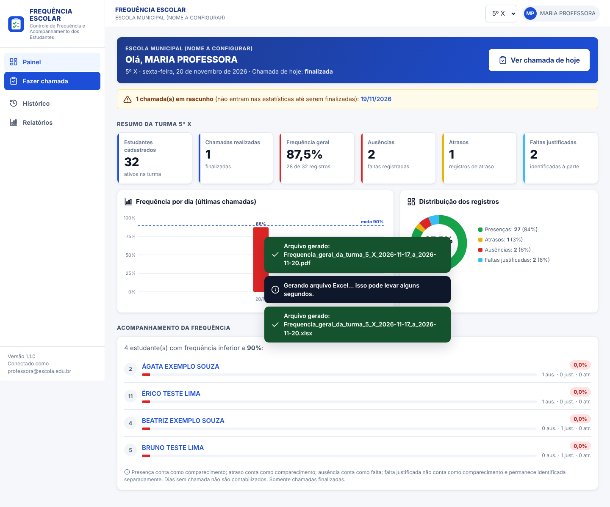
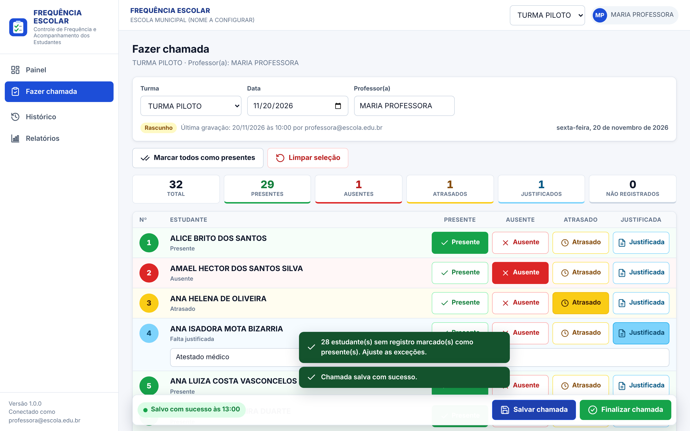
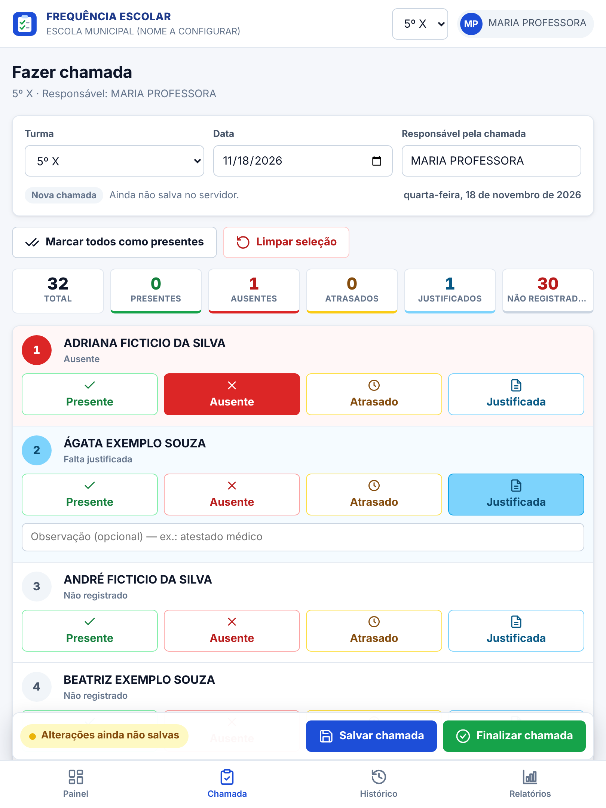
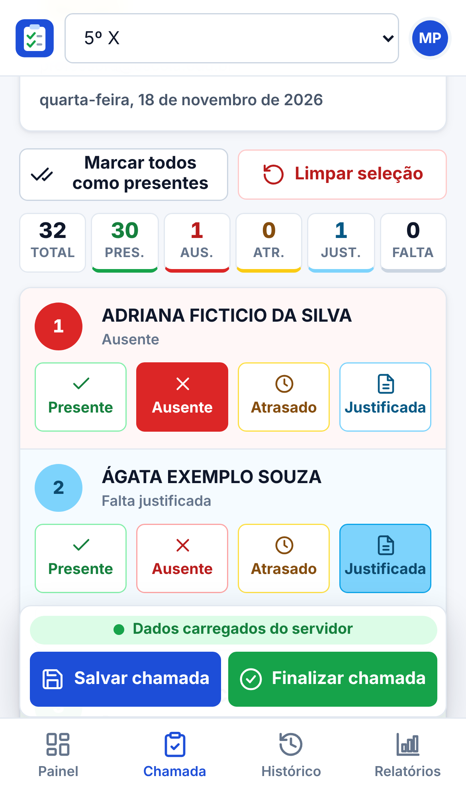
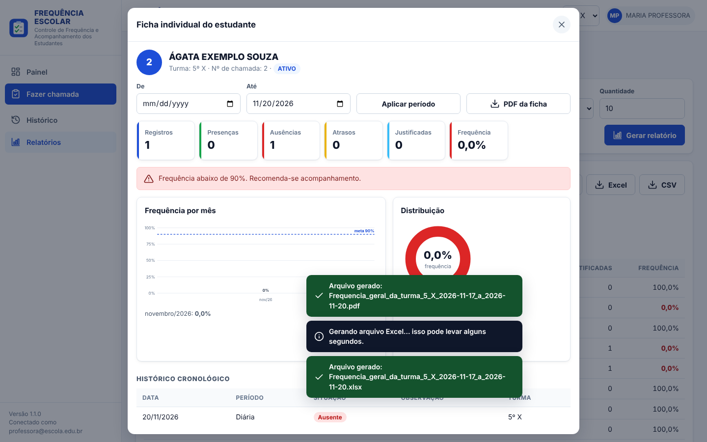

# FREQUÊNCIA ESCOLAR
**Controle de Frequência e Acompanhamento dos Estudantes**

Sistema web de chamada escolar construído só com a infraestrutura Google:
**Google Apps Script** (servidor), **Google Sheets** (banco de dados) e **HTML Service** (interface em HTML5, CSS3 e JavaScript).
Não usa servidores externos, bancos externos nem hospedagem paga.

Piloto: **TURMA PILOTO**, 32 estudantes, início em **17/11/2026**.

| Painel (computador) | Chamada (computador) |
|---|---|
|  |  |

| Chamada (tablet) | Chamada (celular) | Ficha do estudante |
|---|---|---|
|  |  |  |

---

## Sumário
1. [Arquivos do projeto](#1-arquivos-do-projeto)
2. [Instalação passo a passo](#2-instalação-passo-a-passo)
3. [Publicação como Web App (opções exatas)](#3-publicação-como-web-app)
4. [Acesso pelo tablet e atalho na tela inicial](#4-acesso-pelo-tablet-e-atalho-na-tela-inicial)
5. [Segurança e controle de acesso](#5-segurança-e-controle-de-acesso)
6. [Backup e recuperação de dados](#6-backup-e-recuperação-de-dados)
7. [Regras de cálculo da frequência](#7-regras-de-cálculo-da-frequência)
8. [Manual básico de utilização](#8-manual-básico-de-utilização)
9. [Checklist de testes](#9-checklist-de-testes)
10. [Desempenho, limites e manutenção](#10-desempenho-limites-e-manutenção)

---

## 1. Arquivos do projeto

Todos os arquivos que vão para o Google Apps Script estão em **`src/`**:

| Arquivo | Responsabilidade |
|---|---|
| `appsscript.json` | Manifesto: fuso `America/Sao_Paulo`, motor V8 e permissões (escopos). |
| `Code.gs` | Arquivo principal: `doGet()`, `setupSistema()`, `verificarSistema()`, lista dos 32 estudantes, configurações e tratamento padrão de erros da API. |
| `Util.gs` | Datas no fuso de São Paulo, validação de textos e datas, geração de IDs únicos. |
| `Database.gs` | Acesso ao Google Sheets: leitura e escrita em lote, cache (CacheService) e bloqueio de gravações simultâneas (LockService). |
| `Security.gs` | Identidade Google, perfis (ADMIN, GESTOR, PROFESSOR), acesso por turma e prazos de edição. |
| `Attendance.gs` | Chamada: carregar, salvar rascunho, finalizar, reabrir, corrigir e consultar o histórico. |
| `Students.gs` | Cadastros: turmas, estudantes (incluir, editar, transferir, inativar) e usuários. |
| `Reports.gs` | Cálculo da frequência, painel, os 7 relatórios e a ficha individual. |
| `Export.gs` | Exportação em PDF (A4), Excel (.xlsx) e CSV, e exportação completa dos dados. |
| `Audit.gs` | Registro e consulta da auditoria (somente inclusão, nunca exclusão). |
| `Backup.gs` | Backup manual e diário automático numa pasta privada do Drive. |
| `Index.html` | Estrutura da página: menu lateral, barra superior e navegação inferior. |
| `Styles.html` | Identidade visual e layout responsivo (computador, tablet e celular). |
| `JavaScript.html` | Toda a interatividade: telas, salvamento confiável, modo sem conexão e gráficos. |

Fora de `src/`:
- `instalacao/`: pacote pronto em **um único arquivo** `Code.gs` (servidor + telas HTML embutidas), gerado por `node ferramentas/gerar-pacote.js`. Os testes também validam esse pacote: `FE_PACOTE=1 node tests/backend.test.js`.
- `ferramentas/`: gerador do pacote de instalação.
- `tests/`: testes automatizados (simulador do Google Sheets + navegador real).
- `docs/`: capturas de tela.

---

## 2. Instalação passo a passo

> Faça a instalação com a **conta Google que será a "dona" do sistema**, de preferência uma conta **institucional da escola (Google Workspace)**, por exemplo `coordenacao@suaescola.edu.br`. A planilha e os backups ficam no Drive dessa conta. Antes de escolher, leia a [seção 3](#3-publicação-como-web-app).

### 2.1 Criar o projeto
1. Acesse **https://script.google.com** com a conta escolhida.
2. Clique em **Novo projeto**.
3. Clique em "Projeto sem título" (canto superior esquerdo) e renomeie para **FREQUÊNCIA ESCOLAR**.

### 2.2 Ativar o manifesto `appsscript.json`
1. No menu da esquerda, clique na engrenagem **Configurações do projeto**.
2. Marque **"Mostrar arquivo de manifesto 'appsscript.json' no editor"**.
3. Volte para **Editor** (ícone `< >`), abra `appsscript.json`, apague o conteúdo e cole o de `src/appsscript.json`. Salve com **Ctrl+S** (no Mac, **Cmd+S**).

### 2.3 Adicionar os arquivos

> **Caminho mais rápido:** a pasta [`instalacao/`](instalacao/LEIA-ME.md) tem o sistema inteiro num **único arquivo** `Code.gs`, com o servidor e as telas embutidas. Basta colar um arquivo. Siga o [`instalacao/LEIA-ME.md`](instalacao/LEIA-ME.md). As instruções abaixo são para quem prefere os arquivos separados de `src/`.

O projeto já vem com o arquivo `Código.gs`. **Renomeie-o para `Code`** (três pontinhos ao lado do nome → Renomear) e cole nele o conteúdo de `src/Code.gs`.

Depois, para cada arquivo abaixo, clique no **+** ao lado de "Arquivos", escolha o tipo, digite o nome **sem a extensão** e cole o conteúdo correspondente:

| Tipo (botão +) | Nome a digitar | Conteúdo de |
|---|---|---|
| Script | `Util` | `src/Util.gs` |
| Script | `Database` | `src/Database.gs` |
| Script | `Security` | `src/Security.gs` |
| Script | `Audit` | `src/Audit.gs` |
| Script | `Students` | `src/Students.gs` |
| Script | `Attendance` | `src/Attendance.gs` |
| Script | `Reports` | `src/Reports.gs` |
| Script | `Export` | `src/Export.gs` |
| Script | `Backup` | `src/Backup.gs` |
| HTML | `Index` | `src/Index.html` |
| HTML | `Styles` | `src/Styles.html` |
| HTML | `JavaScript` | `src/JavaScript.html` |

Os nomes precisam ser **exatamente** esses, com maiúsculas e minúsculas iguais. Salve tudo (Ctrl+S).

> **Opcional:** em `Code`, preencha `var NOME_ESCOLA_INICIAL = 'NOME DA SUA ESCOLA';` antes de instalar. O nome também pode ser alterado depois, no próprio sistema.

### 2.4 Executar `setupSistema()` e autorizar as permissões
1. Na barra superior do editor, selecione a função **`setupSistema`** e clique em **Executar**.
2. Aparece "Autorização necessária": clique em **Revisar permissões** e escolha a sua conta.
3. Se aparecer **"O Google não verificou este app"**: clique em **Avançado** → **Acessar FREQUÊNCIA ESCOLAR (não seguro)**. Isso é normal para scripts criados pela própria conta; o aviso aparece só para o dono.
4. Clique em **Permitir**. Cada permissão serve para:
   - **Planilhas:** criar e usar o banco de dados.
   - **Drive:** backups e arquivos temporários de exportação.
   - **Documentos:** gerar o PDF em A4.
   - **Serviço externo:** converter relatórios para Excel. Acessa somente o próprio Google (docs.google.com).
   - **Acionadores:** backup diário automático.
   - **E-mail:** identificar quem está usando o sistema.
5. Ao terminar, abra **Registro de execução** (parte inferior da tela). Deve aparecer:
   ```
   Planilha criada: https://docs.google.com/spreadsheets/d/...
   Aba criada: CONFIGURACOES ... AUDITORIA
   Administrador cadastrado: sua.conta@...
   Turma-piloto criada: TURMA PILOTO (...), início em 17/11/2026.
   32 estudante(s) cadastrado(s) na turma-piloto.
   [OK] Os 32 nomes da turma-piloto conferem exatamente com a lista oficial.
   [OK] Numeração de chamada 1 a 32 conferida.
   ✅ INSTALAÇÃO CONCLUÍDA COM SUCESSO.
   ```

**O que o `setupSistema()` faz:** cria a planilha **"FREQUÊNCIA ESCOLAR — Banco de Dados"** no seu Drive, com as 7 abas (CONFIGURACOES, PROFESSORES, TURMAS, ESTUDANTES, CHAMADAS, FREQUENCIAS e AUDITORIA). Também cria cabeçalhos, formatação e proteção, as configurações iniciais, você como ADMIN, a TURMA PILOTO e os 32 estudantes. Guarda o ID da planilha em **Propriedades do script** e valida tudo no final.

**Pode ser executado de novo sem problema**: ele é idempotente, ou seja, não duplica planilha, turma, estudantes nem configurações. Se alguma aba ou coluna tiver sido apagada, ele a recria.

### 2.5 Ativar o backup diário (recomendado)
Selecione a função **`instalarBackupDiario`** → **Executar**. A partir daí, todo dia, entre 19h e 20h, uma cópia completa da planilha é gravada na pasta privada **"FREQUÊNCIA ESCOLAR — Backups"**.

### 2.6 Verificar a qualquer momento
Selecione **`verificarSistema`** → **Executar** e veja o resultado no registro. O ADMIN também pode verificar pelo app, em **Administração → Backup e dados → Verificar sistema**.

---

## 3. Publicação como Web App

### 3.1 Qual configuração usar: depende do tipo de conta

O sistema identifica o usuário pelo e-mail da conta Google (`Session.getActiveUser().getEmail()`). O Google **só informa esse e-mail** nas situações abaixo:

| Situação | O e-mail do usuário é informado? | Resultado |
|---|---|---|
| **Google Workspace da escola** (todos com e-mail `@suaescola.edu.br`), "Executar como: **Eu**" | **Sim**, para usuários do mesmo domínio | ✅ **Configuração recomendada.** Os professores **não** têm acesso à planilha. |
| Conta **Gmail pessoal**, "Executar como: Eu" | **Não**: o Google devolve vazio para qualquer pessoa que não seja o dono | ⛔ O sistema **bloqueia** o acesso (por segurança). Só o dono consegue usar. |
| Gmail pessoal, "Executar como: **Usuário que acessa o app da Web**" | Sim | ⚠️ Funciona, **mas** cada professor precisa ter acesso de **edição** à planilha. Assim ele poderia abri-la direto no Drive, sem passar pelo app. |

**Recomendação:** use uma **conta institucional Google Workspace** (Workspace for Education é gratuito para escolas). Se a escola só tiver contas Gmail pessoais, a alternativa da 3ª linha funciona, mas reduz a proteção da planilha. Nesse caso:
- compartilhe a planilha com os professores como **Editor** (botão Compartilhar da planilha);
- cada professor precisará autorizar as permissões no primeiro acesso;
- a auditoria continua registrando quem alterou o quê, mas edições feitas direto na planilha **não** passam pelas regras do app.

> ⚠️ **Teste obrigatório na sua conta:** depois de publicar, abra o link com uma **segunda conta** (de um professor cadastrado e de alguém não cadastrado) e confirme o comportamento. Esse teste depende da sua conta e das políticas do domínio e não pôde ser feito aqui.

### 3.2 Opções exatas na janela de implantação (Workspace, recomendado)
1. No editor, clique em **Implantar** (canto superior direito) → **Nova implantação**.
2. Clique na engrenagem ao lado de "Selecionar tipo" → **App da Web**.
3. Preencha:
   - **Descrição:** `Versão 1.0 — piloto`
   - **Executar como:** **Eu (sua.conta@suaescola.edu.br)**
   - **Quem pode acessar:** **Qualquer pessoa em *Sua Escola*** (o nome do domínio)
4. Clique em **Implantar**. Se for pedido, autorize novamente.
5. Copie o **URL do app da Web** (termina em `/exec`). **Esse é o link do sistema.**

**Nunca escolha "Qualquer pessoa"** (acesso anônimo). Mesmo nesse caso o sistema bloquearia por não identificar o usuário, mas a página ficaria exposta sem necessidade.

> Domínios escolares às vezes restringem apps do Apps Script. Se o link mostrar erro de permissão do domínio, o **administrador do Google Workspace** precisa liberar em *Admin Console → Segurança → Acesso e controle de dados → Controles de API*, ou confiar no projeto.

### 3.3 Cadastrar os professores
Abra o link (você entra como ADMIN). Vá em **Administração → Usuários → Cadastrar usuário** e informe:
- nome;
- **e-mail da conta Google** do professor;
- perfil **PROFESSOR**;
- a turma **TURMA PILOTO**.

Só e-mails cadastrados e ativos conseguem entrar. **Não existem senhas**: o login é a própria conta Google.

### 3.4 Atualizar o sistema depois de alterar o código
Clique em **Implantar → Gerenciar implantações** → lápis (editar) → **Versão: Nova versão** → **Implantar**. O link continua o mesmo.

> Para testar mudanças antes de publicar, use **Implantar → Testar implantações** (link terminado em `/dev`, visível só para quem edita o projeto).

---

## 4. Acesso pelo tablet e atalho na tela inicial

1. No tablet, abra o **Chrome** (Android) ou o **Safari** (iPad).
2. Entre na conta Google institucional do professor. Se o navegador tiver outra conta conectada, use **"Trocar de conta Google"** na tela de aviso.
3. Abra o link `/exec` do sistema.

**Criar o atalho:**
- **Android (Chrome):** menu **⋮** → **Adicionar à tela inicial** → **Adicionar**.
- **iPad (Safari):** botão **Compartilhar** (quadrado com seta) → **Adicionar à Tela de Início** → **Adicionar**.

**Limitações reais (Google Apps Script):** o app roda dentro de uma página do Google, então **não é um PWA instalável** e **não funciona offline por completo**. O atalho abre o navegador no link do sistema. O nome sugerido para o atalho é "Frequência". O **ícone do atalho** costuma ser genérico ou uma miniatura da página, porque o Apps Script não permite definir o `apple-touch-icon`. Opcionalmente, o ADMIN pode informar em **Configurações → Ícone** o endereço `https://` público de uma imagem PNG. Ela passa a ser usada como ícone da aba do navegador (favicon).

---

## 5. Segurança e controle de acesso

| Medida | Como foi implementada |
|---|---|
| Acesso restrito | `doGet()` só entrega a interface para e-mails **cadastrados e ativos** na aba PROFESSORES. Os demais veem "Acesso não autorizado", sem nenhum dado. |
| Identidade confirmada | Se o Google não informar o e-mail, **todas** as operações são bloqueadas. Não existe tela de login falsa nem senha em planilha. |
| Perfis | **ADMIN**: tudo. **GESTOR**: todas as turmas, correções a qualquer tempo, relatórios e estudantes. **PROFESSOR**: só as turmas atribuídas, com edição limitada a `DIAS_EDICAO_PROFESSOR` dias (padrão 7). |
| Validação no servidor | Toda função `api*` revalida usuário, perfil, turma, datas, situações e textos. Os botões escondidos na tela são só conveniência. |
| Funções administrativas protegidas | `setupSistema`, `verificarSistema`, `instalarBackupDiario`, `fazerBackupAgora` e `backupAgendado` recusam chamadas que não sejam do instalador ou de um ADMIN. Isso vale também para quem tentar chamá-las pelo navegador. |
| Planilha protegida | No modo recomendado, a planilha pertence à conta dona e **não é compartilhada**. As abas têm proteção "com aviso" contra edição manual acidental. |
| Nenhuma credencial no navegador | O navegador recebe só nome, e-mail e perfil do próprio usuário e a lista de turmas. Nenhum ID de planilha ou token é enviado. |
| Auditoria | Cada criação, alteração, finalização, reabertura, correção, cadastro, configuração, exportação e backup gera uma linha em AUDITORIA, com usuário, data/hora, valores anterior e novo, e motivo. Não há função que apague histórico. |
| Proteção contra fórmulas | Textos que começam com `=`, `+` ou `@` são neutralizados (na planilha e no CSV). |
| Nada é apagado | Estudantes e turmas são **inativados**, nunca excluídos. Transferências preservam o histórico na turma de origem. |

---

## 6. Backup e recuperação de dados

**Backups**
- **Automático:** todo dia, entre 19h e 20h, depois de executar `instalarBackupDiario` uma vez.
- **Manual:** pelo app, em **Administração → Backup e dados → Fazer backup agora**, ou pela função `fazerBackupAgora` no editor.
- Cada backup é uma **cópia completa** da planilha com data e hora no nome (`BACKUP Frequência Escolar 2026-11-17_19-04`), na pasta privada **FREQUÊNCIA ESCOLAR — Backups**.
- Backups **nunca são apagados automaticamente**. Cada resultado (sucesso ou falha) é registrado na AUDITORIA e em `ULTIMO_BACKUP`.
- **Exportação completa:** em **Administração → Backup e dados → Exportar todos os dados (.xlsx)**.

**Como restaurar**
1. **Erro pequeno** (ex.: alguém editou a planilha manualmente): na planilha principal, use **Arquivo → Histórico de versões → Ver histórico de versões** e restaure uma versão anterior. Depois, no editor, execute `verificarSistema`.
2. **Recuperação completa a partir de um backup:**
   1. No Drive, abra a pasta **FREQUÊNCIA ESCOLAR — Backups** e escolha o backup.
   2. Faça uma cópia dele (**Arquivo → Fazer uma cópia**) e renomeie para `FREQUÊNCIA ESCOLAR — Banco de Dados (restaurado)`.
   3. Copie o ID da cópia: é o trecho do endereço entre `/d/` e `/edit`.
   4. No editor do Apps Script: **Configurações do projeto → Propriedades do script** → edite `SPREADSHEET_ID` e cole o novo ID → **Salvar**.
   5. Execute `verificarSistema`. O sistema passa a usar a planilha restaurada, e o link do app não muda.
   6. Guarde a planilha antiga (não apague) até confirmar que está tudo certo.
3. **Planilha principal apagada por engano:** restaure-a da **Lixeira do Google Drive** (por até 30 dias). Por segurança, o `setupSistema` **não** cria uma planilha nova em cima de uma referência existente.

---

## 7. Regras de cálculo da frequência

**Frequência (%) = comparecimentos ÷ registros considerados × 100**

| Situação | Padrão | Configuração |
|---|---|---|
| Presente | Comparecimento | — |
| Atrasado | Comparecimento (identificado à parte) | `ATRASO_CONTA_COMPARECIMENTO` (SIM/NÃO) |
| Ausente | Falta | — |
| Falta justificada | Identificada à parte; **não** conta como comparecimento; entra na base de cálculo | `JUSTIFICADA_CONTA_COMPARECIMENTO`, `JUSTIFICADA_EXCLUIR_DO_CALCULO` |
| Não registrado | Não conta | — |
| **Dia sem chamada** | **Não conta** (nunca vira falta) | — |
| Chamada em rascunho | Não entra nas estatísticas | `CONTAR_RASCUNHOS` |

O limite de alerta é configurável: `LIMITE_FREQUENCIA`, padrão 90%. Todas as regras são alteradas em **Administração → Configurações**, e cada alteração fica registrada na auditoria.

---

## 8. Manual básico de utilização

### Professor: fazer a chamada (uso diário)
1. Abra o atalho do sistema. O **Painel** mostra a turma, a data de hoje e os indicadores.
2. Toque em **Fazer chamada**. A data de hoje já vem preenchida (horário de São Paulo).
3. Todos os estudantes começam como **NÃO REGISTRADO**. Ninguém é marcado presente automaticamente.
4. Para cada estudante, toque em **Presente** (verde), **Ausente** (vermelho), **Atrasado** (amarelo) ou **Justificada** (azul-claro).
   - **Atalho:** **Marcar todos como presentes** marca só quem ainda não tem registro. Depois, ajuste as exceções.
   - Em **Justificada**, aparece um campo opcional para observação (ex.: "atestado médico").
5. Os contadores no topo (Total, Presentes, Ausentes, Atrasados, Justificados e Não registrados) se atualizam a cada toque.
6. O sistema **salva sozinho** alguns segundos depois de cada alteração. O botão **Salvar chamada** salva na hora.
7. Ao terminar, toque em **Finalizar chamada** e confirme. Só é possível finalizar com **todos** os estudantes registrados. Se faltar alguém, o sistema mostra quem é e oferece salvar como rascunho.

**Mensagens de salvamento:**
- **Alterações ainda não salvas**: aguardando envio.
- **Salvando...**: enviando ao servidor.
- **Salvo com sucesso às HH:MM**: o servidor confirmou a gravação.
- **Tentando novamente (1/3)**: houve falha e o sistema está reenviando sozinho.
- **Erro ao salvar** ou **Sem conexão**: as marcações estão **guardadas só neste aparelho** e **ainda não** no servidor. Quando a internet voltar, o envio é automático. Se você fechar o app antes disso, ao reabrir a mesma chamada aparecerá **"Restaurar e salvar"**.

**Corrigir uma chamada finalizada:** abra a chamada (pela data ou pelo Histórico) → **Reabrir para correção** → informe o motivo → corrija → finalize de novo. Fora do prazo do professor, só a equipe gestora pode corrigir.

### Histórico
Filtre por período, estudante, situação e status. Toque numa chamada para ver todos os estudantes, **Corrigir** um registro (com motivo, que fica na auditoria) ou abri-la na tela de chamada.

### Relatórios
Escolha o relatório:
- frequência diária, semanal ou mensal;
- frequência individual;
- frequência geral da turma;
- estudantes com mais faltas;
- estudantes abaixo do limite.

Defina o período (atalhos: Hoje, Esta semana, Este mês, Mês anterior e Desde o início) → **Gerar relatório** → exporte em **PDF** (A4), **Excel** ou **CSV**. Os arquivos trazem escola, turma, período, professor, data de emissão e as regras de cálculo.

### Ficha do estudante
Toque no **nome** de qualquer estudante, no painel, na chamada, em relatórios ou na lista de estudantes. A ficha mostra os totais, o percentual, os gráficos e o histórico cronológico, com filtro de período e PDF.

### Equipe gestora (GESTOR/ADMIN)
- **Estudantes:** adicionar (o número de chamada é automático), editar nome e número, transferir de turma, inativar (com motivo e data) e reativar.
- **Administração** (ADMIN):
  - turmas: criar, editar e inativar;
  - usuários: cadastrar e desativar acesso;
  - configurações: nome da escola, regras de cálculo, períodos/aulas e prazos;
  - backup, exportação completa e verificação do sistema;
  - auditoria completa com filtros.

**Aulas/períodos:** se a escola fizer chamada por aula, preencha **Configurações → Aulas/períodos** (ex.: `1ª aula;2ª aula`). Vazio significa uma chamada por dia.

---

## 9. Checklist de testes

### 9.1 Testes automatizados (já executados)
O código `.gs` real roda num simulador do Google Apps Script/Sheets (`tests/gas-mock.js`). Esse simulador imita, inclusive, a conversão automática de datas do Sheets e o limite de linhas da planilha. A interface real roda no navegador Chromium.

```bash
cd frequencia-escolar
node tests/backend.test.js
```

```bash
node tests/ui.test.js
```

O primeiro comando roda **45 testes de backend**. O segundo roda **22 testes de interface** (precisa do pacote `playwright` instalado) e gera capturas em `tests/capturas/`.

| Item obrigatório | Coberto por | Resultado |
|---|---|---|
| Inicialização (`setupSistema`) e idempotência (3 execuções) | backend | ✅ |
| Cadastro dos 32 estudantes, nomes exatos, numeração 1–32, IDs únicos | backend | ✅ |
| Criação de chamadas; uma por turma/data/período | backend | ✅ |
| Marcação de presença, ausência, atraso e falta justificada | backend + interface | ✅ |
| Salvamento no Sheets em lote (≤ 4 `setValues` por gravação) | backend | ✅ |
| Recuperação após fechar e reabrir | backend + interface | ✅ |
| Edição, correção e reabertura com motivo | backend + interface | ✅ |
| Histórico de alterações (auditoria com valores anterior/novo, usuário, data, motivo) | backend | ✅ |
| 7 relatórios e cálculos (dias sem chamada não contam) | backend + interface | ✅ |
| Exportação CSV (conteúdo validado), PDF e Excel (download no navegador) | backend + interface | ✅ (*) |
| Controle de acesso: sem identidade, não cadastrado, perfis, turmas, prazos | backend + interface | ✅ |
| Uso em tablet (iPad e Android: botões ≥ 52 px, sem rolagem lateral) e celular | interface | ✅ |
| Uso em computador (menu lateral, tabela) | interface | ✅ |
| Perda de conexão: avisa, não indica "salvo", guarda no aparelho, restaura | interface | ✅ |
| Gravações simultâneas: conflito detectado sem sobrescrever; reenvio sem duplicar | backend + interface | ✅ |
| Crescimento (60 chamadas, mais de 1.900 registros, expansão automática da planilha) | backend | ✅ |

(*) No simulador, PDF e Excel validam toda a lógica e as chamadas de API, mas o arquivo final é gerado pelo Google. Por isso, confira um PDF e um Excel reais no item 9.2.

### 9.2 Testes no ambiente real (fazer antes de 17/11/2026)
Estes testes dependem da sua conta Google e não podem ser feitos fora dela:

- [ ] `setupSistema` executado; registro mostra "INSTALAÇÃO CONCLUÍDA COM SUCESSO".
- [ ] A planilha "FREQUÊNCIA ESCOLAR — Banco de Dados" existe no seu Drive, com 7 abas e 32 estudantes.
- [ ] `instalarBackupDiario` executado; **Fazer backup agora** cria uma cópia na pasta de backups.
- [ ] Publicado como App da Web conforme a seção 3.2; link `/exec` copiado.
- [ ] **Com a conta de um professor cadastrado**, o link abre e mostra o nome dele. *(Confirma a identificação pelo Google.)*
- [ ] **Com uma conta não cadastrada**, aparece "Acesso não autorizado".
- [ ] O professor **não** consegue abrir a planilha pelo Drive (no modo Workspace recomendado).
- [ ] Fazer uma chamada de teste numa data já passada, finalizar e conferir na aba CHAMADAS/FREQUENCIAS. Depois, se quiser, corrigir (fica auditado).
- [ ] Gerar e abrir um **PDF** (papel A4) e um **Excel** de relatório.
- [ ] No **tablet da sala**: abrir, criar o atalho na tela inicial e fazer uma chamada completa.
- [ ] Ligar o modo avião no meio de uma chamada: aparece o aviso vermelho; ao voltar a internet, salva sozinho.
- [ ] Preencher o **nome da escola** em Administração → Configurações.

---

## 10. Desempenho, limites e manutenção

- **Otimizações:**
  - leitura em lote (`getValues`) e escrita em lote (`setValues`);
  - busca de registros por `TextFinder` (não lê a aba inteira para abrir uma chamada);
  - `CacheService` para configurações, usuários, turmas e estudantes;
  - `LockService` nas gravações;
  - controle de versão contra sobrescritas;
  - repetição automática com espera crescente.
- **Capacidade esperada:** uma turma de 32 estudantes gera cerca de 6.400 registros por ano letivo, folgado para o Google Sheets. O sistema suporta várias turmas e crescimento gradual. Ele **não promete uso ilimitado**: o Apps Script tem cotas (tempo de execução, execuções simultâneas por usuário, limite de 10 milhões de células por planilha). Gravações simultâneas são enfileiradas e levam de 1 a 3 segundos cada.
- **Recomendação para anos seguintes:** ao final do ano letivo, faça backup e comece uma nova planilha. Para isso, apague a propriedade `SPREADSHEET_ID` e execute `setupSistema` novamente, guardando o ID antigo para consulta.
- **Logs de erro:** veja **Execuções** no editor do Apps Script. Erros internos aparecem ali, enquanto o usuário vê só uma mensagem amigável.
